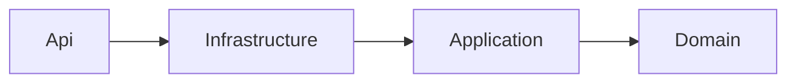
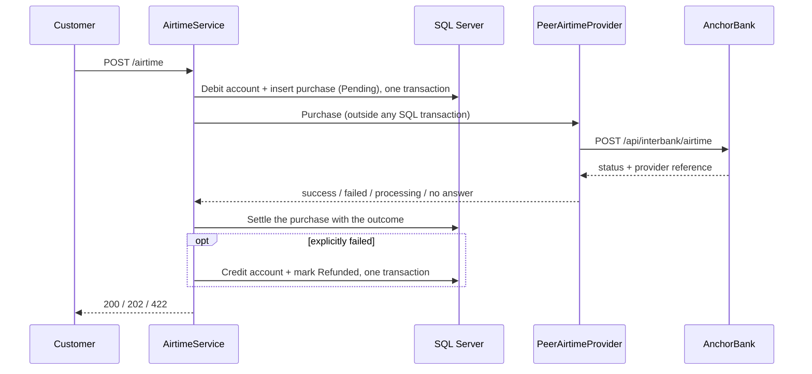

# BridgeBank

BridgeBank is **bank B** in a two-bank demo; **AnchorBank is bank A**. The code is AnchorBank's, copied and renamed, with its own bank code, port and database. The deliberate difference is that this bank holds no VTpass credentials at all: when a customer buys airtime here, AnchorBank makes the purchase over the interbank API and this bank settles with its own customer.

What it demonstrates is the part of banking software that isn't local: money leaving one bank's database and landing in another's, and a bank that can sell airtime without holding the provider's keys.

## What I wanted to get right

- **Money moves atomically.** A debit without its matching record, or a transfer that only half happens, should be impossible.
- **Never guess about money.** When an outside provider times out, I don't know if the airtime was delivered, so the code doesn't pretend to know. It only refunds when the provider says it failed.
- **Ownership can't be bypassed.** Asking for someone else's account looks the same as asking for one that doesn't exist.
- **A payment can't happen twice.** Every transfer and airtime purchase carries a reference from the client, and the database refuses to use one twice, so a retry that arrives after a timeout returns the original answer instead of moving the money again.
- **This bank can't reach the provider.** There is no VTpass URL and no keys in this repo, so airtime has to go through AnchorBank.

## Built with

.NET 10 and ASP.NET Core controllers, SQL Server 2022 (in Docker) through Dapper, JWT auth with PBKDF2 password hashing, and xUnit. No EF Core. There is no provider client here: airtime comes from AnchorBank over HTTP.

## How it's organised

Four projects, with dependencies pointing inward only:



```
BridgeBank.Api/             controllers, auth wiring, Swagger
BridgeBank.Application/     services, request records, interfaces
BridgeBank.Domain/          entities, enums, and the business rules
BridgeBank.Infrastructure/  Dapper repositories, SQL scripts, the interbank client
```

There's one test project per layer, plus one that boots the whole API.

The interface is what makes the arrangement work: `IAirtimeProvider` lives in Application and `PeerAirtimeProvider` implements it in Infrastructure by calling the other bank. `AirtimeService` doesn't know the difference, so the debit, settle and refund code here is exactly what AnchorBank runs.

## Try it in a few minutes

Once it's running (setup is below), open Swagger and follow this path:

1. Register a customer and log in. Copy the `accessToken`.
2. Click **Authorize** and paste the token (just the token, see the gotcha below).
3. Create an account and deposit some money into it.
4. Buy airtime with `08011111111`, AnchorBank's sandbox success number. AnchorBank makes the purchase, so you get `200` and the balance drops by the amount.
5. Buy again with `08022222222`. The sandbox treats any other number as a failure, so this bank refunds and answers `422`, and the transaction list shows the debit followed by the credit.

## Getting started

### You'll need

- The .NET 10 SDK
- Docker, for SQL Server 2022
- Bank A, AnchorBank, running on `https://localhost:7176` with its VTpass sandbox keys and the airtime products whitelisted. It makes the purchase; this bank has no provider account of its own.

### 1. Database

Start SQL Server in Docker, create a database called `BridgeBank`, then run the scripts in `BridgeBank.Infrastructure/Database/Scripts` in numeric order.

### 2. Secrets

The connection string and keys aren't in the repo. They go in user secrets:

```bash
dotnet user-secrets set "Jwt:SigningKey" "<at least 32 characters>" --project BridgeBank.Api
dotnet user-secrets set "ConnectionStrings:DefaultConnection" "Server=localhost,1433;Database=BridgeBank;User Id=sa;Password=<password>;TrustServerCertificate=True;" --project BridgeBank.Api
dotnet user-secrets set "Interbank:PeerSecret" "<shared with AnchorBank>" --project BridgeBank.Api
```

The settings that aren't secret live in `appsettings.json`: JWT issuer and audience, this bank's code (`BRDG`), the peer's code (`ANCHOR`) and base URL, and the addresses allowed to call `/api/interbank`.

### 3. Run

```bash
dotnet run --project BridgeBank.Api
```

Then open <https://localhost:7177/swagger>.

> **A gotcha worth knowing:** paste only the token into Swagger's Authorize box. The document already declares the bearer scheme, so typing `Bearer` in front sends `Bearer Bearer eyJ...` and every call comes back `401 invalid_token`. It looks like a bug in your own auth code, and it isn't.

## Endpoints

Register and login are public and rate limited (5 registrations per 10 minutes, 5 logins per minute). Everything else needs the token.

| Method | Path | What it does |
|---|---|---|
| POST | `/api/auth/register` | Create a customer |
| POST | `/api/auth/login` | Get an access token |
| POST | `/api/account` | Open an account (the owner comes from the token, not the body) |
| GET | `/api/account` | List my accounts |
| GET | `/api/account/{id}` | One of my accounts |
| GET | `/api/account/{id}/balance` | Balance |
| GET | `/api/account/{id}/transactions?page=1&pageSize=20` | Transaction history |
| POST | `/api/account/{id}/deposit` | Deposit |
| POST | `/api/account/{id}/withdraw` | Withdraw |
| POST | `/api/account/{sourceId}/transfers` | Transfer to another account here, or to AnchorBank with `destinationBankCode` |
| POST | `/api/account/{id}/airtime` | Buy airtime (bank A makes the purchase) |
| POST | `/api/interbank/credits` | AnchorBank pays money into an account here |
| POST | `/api/interbank/airtime` | AnchorBank asks this bank to buy airtime, which it relays back |
| GET | `/api/customer/{id}` | My own record |

Ownership is a `WHERE` clause in the queries, not a check in a service. That's why someone else's account gives a `404` and not a `403`: it simply isn't visible to you.

The two interbank paths don't take a JWT, because the caller is a bank and not a customer. They check two things: the caller's address is in `Interbank:AllowedCallers`, and it sends the shared secret in `X-Bank-Secret`. Anything else gets `403` or `401` before the action runs.

## How money moves

Deposits, withdrawals and transfers each run in a single SQL transaction: lock the account rows with `UPDLOCK, ROWLOCK`, check the locked values, update, write the transaction row, commit.

A transfer locks both accounts in one query, ordered by `Id`. Without that ordering, two transfers in opposite directions deadlock each other. I only truly believed it once the concurrency test failed without it.

### Sending money to bank A (AnchorBank)

An interbank transfer can't be one transaction, because half of it happens in someone else's database. So the debit and a `Pending` transfer row are committed first, and only then is AnchorBank called. If it accepts, the row becomes `Completed`. If it refuses (account not found, inactive), the amount is refunded, a reversal transaction is written and the row becomes `Failed`. If it doesn't answer at all, you get `502` and the row stays `Pending` with the money debited — the honest state, since the money may well have arrived.

A retry with the same `clientReference` resends the *stored* amount and destination rather than the request's, and AnchorBank's own record of `(sending bank, account, reference)` stops it crediting twice. That's the part I care most about: the sender can safely retry, because the receiver is the one that enforces once-only.

## Buying airtime



The account is debited and the purchase row saved **before** the other bank is called, so there's always a record with its `request_id`, whatever happens next. The call itself sits outside any SQL transaction. Otherwise a slow bank would hold a lock on the customer's account for up to 30 seconds, and a crash would erase the only evidence that a request might have gone out. This bank holds the customer's money, so it is the one that refunds.

### Reading bank A's answer

The interbank endpoint answers with the purchase's status and VTpass's reference, so this bank never parses the provider's JSON at all:

| Answer | Means | Purchase becomes |
|---|---|---|
| `Success` | It worked | Success |
| `Failed` | It definitely didn't | Failed, then Refunded |
| `Processing` | Still working on it | Processing |
| `Unknown`, an error status, a timeout, a network error | We don't know | Unknown |

The rule behind the table is that **only an explicit failure refunds**. A timeout doesn't mean the airtime wasn't delivered — AnchorBank may have bought it and only the answer got lost — so refunding on one could hand a customer their money back *and* their airtime. That's why `Unknown` exists as its own state, and why a connection failure comes back as `Unknown` instead of throwing.

### The purchase lifecycle

| Status | Meaning |
|---|---|
| Pending | Saved and debited; the other bank hasn't answered yet |
| Processing | The other bank says it's in progress |
| Unknown | No usable answer |
| Success | Delivered (final) |
| Failed | The provider said no, so a refund is owed |
| Refunded | Money returned (final) |

The entity enforces the transitions: `Pending`, `Processing` and `Unknown` can move to `Success` or `Failed`, only `Failed` can move to `Refunded`, and `Success` and `Refunded` can never change again. The refund also updates `WHERE Status = Failed` and checks the affected row count, so the same purchase can't be refunded twice.

### What the endpoint returns

`POST /api/account/{id}/airtime`

```json
{ "network": 1, "phoneNumber": "08011111111", "amount": 100 }
```

`network` is `1` for MTN, `2` for Glo, `3` for Airtel and `4` for Etisalat (9mobile).

| Status | Meaning |
|---|---|
| `200` | Delivered |
| `202` | Still processing or unknown; the money stays debited until it's resolved |
| `422` | Failed and refunded |
| `409` | Insufficient funds, or the account isn't active |

## When something goes wrong

| You see | Likely cause |
|---|---|
| `401 invalid_token` in Swagger | A leftover `Bearer ` prefix, an expired token, or a changed `Jwt:SigningKey`. Check the `www-authenticate` response header for the exact reason. |
| `400` mentioning "11 digits starting with 0" | The phone number isn't in quotes in your JSON. `"08011111111"` is a string, but `08011111111` is an invalid number. |
| `422` with a `028` message | AnchorBank's sandbox account doesn't have that product whitelisted. Fix it there, not here. |
| "Could not reach the other bank" in `ProviderMessage` | AnchorBank isn't running. The row is `Unknown` and the money is still debited. |
| `401` or `403` on `/api/interbank/...` | The caller's address isn't in `Interbank:AllowedCallers`, or its `X-Bank-Secret` doesn't match `Interbank:PeerSecret`. |
| `502` from a transfer | AnchorBank didn't answer. The money is still debited and the transfer is `Pending`; retry with the same `clientReference`. |
| `202` where you expected `200` | The purchase landed in `Processing` or `Unknown`. Look at `ProviderMessage` on the `AirtimePurchases` row. |

## Tests

```bash
dotnet test BridgeBank.slnx
```

- **Domain** tests cover the entity rules, including which airtime statuses may follow which.
- **Application** tests use hand-written fakes, since there's no mocking library in the solution.
- **Infrastructure** tests hit a real SQL Server. The fixture creates and drops `BridgeBankTests` from the scripts, so a new script is picked up automatically.
- **API** tests boot the real pipeline with `WebApplicationFactory` and mint tokens directly, which keeps the login rate limiter out of the way.

There is no provider client here, so the tests that covered VTpass's JSON aren't in this repo. What is tested is everything this bank does itself, plus the interbank guard, which is exercised as middleware with a `DefaultHttpContext` because the in-memory test host has no caller address.

## What's next, and what's missing

- **Reconciliation.** A purchase that ends up `Processing` or `Unknown` just sits there, and this bank can't resolve it alone: `PeerAirtimeProvider.RequeryAsync` answers Unknown because the interbank API doesn't expose requery yet. Clearing those rows is a manual job today.
- **Pending interbank transfers need a nudge.** If bank A stays down, the transfer sits `Pending` with the money debited and nothing resolves it on its own.
- **Settlement between the banks.** AnchorBank pays VTpass for this bank's airtime and nothing squares that debt up.
- **Data purchases**, which would reuse most of the airtime machinery.
- **Idempotency keys on deposits and withdrawals.** Transfers and airtime have them; the two simple money endpoints still don't.
- **Refresh tokens.**
- **Test gaps.** Nothing exercises `AirtimeService` end to end, and the double-refund guard is only proven by reading the code.
